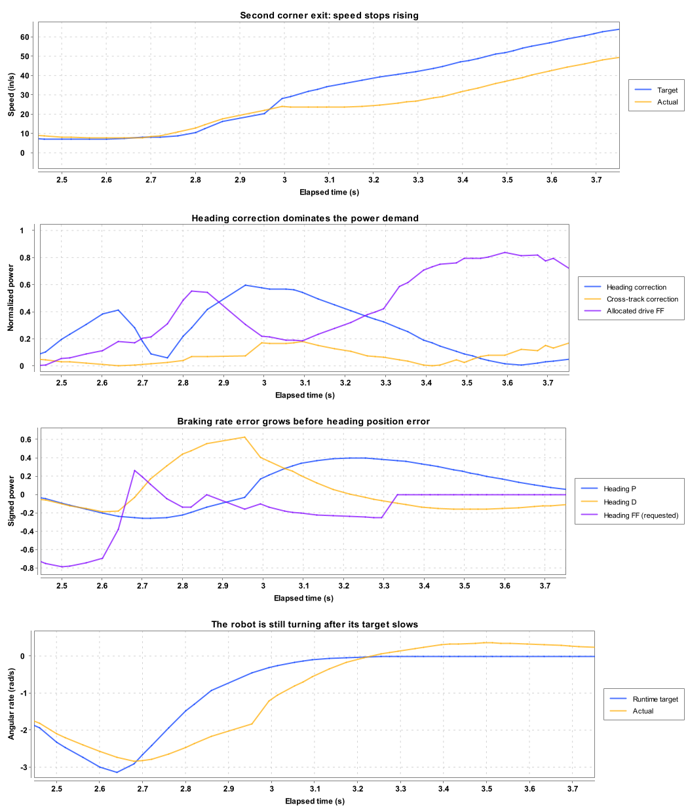

# AutoTest acceleration shelves: measured cause

The dominant correction during the repeated speed shelves is heading correction. The shelves align with corner-exit angular braking, about half a second after each curvature peak. They are not tied to a 25 in/s limiter.

## Evidence and scope

Analyzed the shared-feedforward allocator run recorded in `build/shelf-investigation/baseline.csv` (original `auto-test-outbound-velocity_20260922_201002_868.csv`). This run completed all movements in 15.79 s and passed the loop-timing guard. All conclusions below describe the desktop simulator, not a hardware measurement.

## What repeats

The outbound route uses four similar turns with arc parameter 7 and TANGENT_OPTIMAL heading. At the curvature peaks, actual speed is 6.8–7.7 in/s and nominal angular target is approximately -2.6 to -3.1 rad/s. Each acceleration shelf occurs 0.45–0.55 s and 7.5–9.0 inches later, while exiting the corner.

The following flat-core samples have nominal target acceleration above 40 in/s² and absolute measured acceleration below 10 in/s². Measured acceleration uses a centered five-sample velocity difference, so these intervals describe the flat core, not the entire recovery. Values are sample means.

| Turn exit | Flat-core time (s) | Actual speed (in/s) | Actual acceleration (in/s²) | Planned acceleration (in/s²) | Heading correction magnitude | Cross-track correction magnitude |
|---|---:|---:|---:|---:|---:|---:|
| 1 | 1.616–1.716 | 26.12 | -0.61 | 87.95 | 0.566 | 0.188 |
| 2 | 3.055–3.135 | 23.69 | 2.11 | 68.34 | 0.544 | 0.169 |
| 3 | 5.029–5.191 | 24.06 | -1.77 | 67.04 | 0.556 | 0.174 |
| 4 | 7.017–7.210 | 23.84 | 0.47 | 70.65 | 0.567 | 0.170 |

Tangential position correction is zero in these intervals. Centripetal demand is small as the path straightens. Heading correction is approximately three times cross-track correction. The entries are component magnitudes, not additive wheel-power percentages; the allocator transforms translation into robot coordinates before budgeting it.

## One sample shows the mechanism

At 3.094915 s:

- Actual speed: 23.664 in/s; target: 34.302 in/s; planned acceleration: 66.855 in/s².
- Heading correction: 0.546; cross-track correction: 0.182; centripetal: 0.006; tangential position correction: 0.
- Correction is unscaled and reserves 0.744 of the conservative command budget.
- Translation feedforward requests 0.841 but receives 0.186 (22.16%).
- Translation velocity feedback requests 0.880 but receives zero: the remaining budget has already been allocated.
- Nominal angular target: -0.140 rad/s. The runtime target after progress-speed scaling is about -0.099 rad/s; actual angular velocity is -0.561 rad/s.

The heading controller is braking ongoing negative rotation. As heading error grows, its position term replaces the initially large derivative term. At 2.955 s, heading P contributes -0.027 and D contributes +0.626, giving +0.600. At 3.075 s, P contributes +0.310 and D +0.253. At 3.215 s, P contributes +0.399 and D only +0.009.

Thus, the acceleration collapse begins before actual angular velocity reverses sign. The earlier handoff's emphasis on the later positive angular-velocity overshoot was incomplete. That overshoot occurs during recovery; the initial braking lag already demands substantial correction.

## A second contributor: opposing commands

Heading feedforward contains `kV * targetOmega + kA * targetAlpha + kS * sign(targetOmega)`, with progress-speed scaling on omega and alpha. Near the corner exit, omega is still slightly negative, so the angular static/friction term remains about -0.257 even as rotation approaches zero.

At 3.095 s, the full requested heading feedforward is -0.203, opposite the +0.546 heading correction. Only -0.045 is allocated. The allocator reserves magnitudes for both stages before summing them, so this cancellation also leaves some actual motor authority unused: maximum motor command is 0.861 despite zero remaining allocator budget.

This is an observed command conflict, not proof that angular friction compensation should be removed. Its size, the angular acceleration model, progress scaling, and the conservative treatment of opposing commands deserve the next controlled investigation.

## Controlled comparisons

Temporary test-only changes were restored byte-for-byte after the experiments. Production controller gains were not changed. Comparison speeds below use the same second-exit path-distance interval, 64–66 inches, rather than the same wall-clock time.

| Experiment | Mean speed at 64–66 in | Mean heading correction | Mean cross-track correction | Peak outbound heading error | Outcome |
|---|---:|---:|---:|---:|---|
| Baseline | 23.68 in/s | 0.560 | 0.174 | 13.11° | Passed |
| Half heading P and D | 29.09 in/s | 0.405 | 0.237 | 18.70° | Passed, worse heading accuracy |
| Zero translational P/D/S | 21.94 in/s | 0.496 | 0 | 86.96° over failed run | Outbound timed out; trajectory divergence limits comparison |
| Zero angular feedforward kS | 21.07 in/s | 0.365 | 0.113 | 18.91° | Completed movements, failed loop-timing guard; exit effects varied |

Halving heading gains also moved the corresponding first, third, and fourth exit speeds to 30.40, 29.09, and 28.31 in/s, respectively. This supports the explanation that the repeatable shelf speed comes from the repeated dynamics and allocation, rather than an intrinsic speed threshold. These are single-run probes, not statistically controlled performance benchmarks.

Removing angular kS released translation power and reduced correction at some exits, but inconsistent loop timing and increased heading error prevent treating it as a validated fix. Removing cross-track control destabilized the route and is not a useful solution.

After restoring the test source, the 23 focused unit tests passed. The final baseline rerun completed all movements but failed the desktop loop-timing guard (27.5 ms at the assertion versus a 17–23 ms requirement). This reinforces the timing limitation on cross-run comparisons; the time-aligned baseline evidence above comes from the earlier passing run.

## Correlation versus cause

Across the four exit/recovery windows (1.45–1.95, 2.9–3.45, 4.9–5.5, 6.9–7.5 s), Pearson correlation with smoothed actual acceleration is -0.67 for heading correction, -0.83 for cross-track correction, and +0.81 for allocated translation feedforward. Cross-track correction has the stronger simple correlation because both corrections evolve through the same turn-exit transient; correlation alone does not identify the larger budget consumer. The command magnitudes, allocation trace, temporal ordering, and heading-gain experiment together identify heading correction as the dominant allocation burden.

## Next work

Keep correction priority. Investigate why planned angular braking under-delivers, including the angular feedforward model and its near-zero friction term, and quantify the authority discarded when feedforward opposes correction. Reducing gains shifts the symptom but worsens heading accuracy. The shared translation/heading feedforward change fixes the unintended priority but does not eliminate this underlying braking/recovery transient.

Code references: `follower/HolonomicPathFollower.java` (angular targets/feedforward and cross-track correction), `follower/Follower.java` (`calculatePathHeadingFeedback`), `follower/HolonomicCommandAllocator.java` (stage budgets), and `AutoTest.java` (`buildHolonomicPath`).
